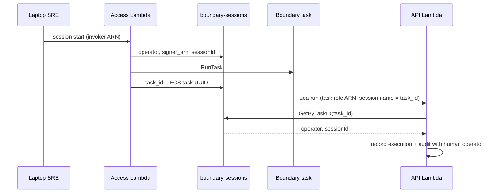

# ZOA Boundary — Identity bridge

The **identity bridge** is how ZOA attributes **Trusted Actions** and **API audit** to a **human SRE** when the HTTP caller is an **ECS task role** shared by every boundary container on a target. Without it, audit would show only an ECS task UUID, not `slopezma`.

**Operator guide (credentials and workflow):** [Operator workflow — Identity and SigV4](../guides/operator-workflow.md#identity-and-sigv4).  
**Session row storage and GSIs:** [Storage — boundary sessions](../architecture/storage.md#boundary-sessions).

## Three different “session” identifiers (do not mix them)

| Name                                       | Example                                | Who assigns it                          | Used for                                                                                 |
| ------------------------------------------ | -------------------------------------- | --------------------------------------- | ---------------------------------------------------------------------------------------- |
| **ZOA boundary `session_id`**              | `bcacb5bb-041b-47e7-b839-6ad619f6a91b` | Access at `session_start` (DynamoDB PK) | Audit join key on executions/audit; shell prompt `sessionId:…`; `zoa session terminate`  |
| **ECS task id** (`task_id` on session row) | `699b33207f394816a9ecf16b6789174e`     | ECS at `RunTask`                        | **Identity bridge lookup key**; last segment of boundary **`signer_arn`**                |
| **ECS Exec / SSM session id**              | `irrn2yhacfirattxuxr82p2jla`           | AWS when you `session join`             | CloudWatch stream `ecs-execute-command-<id>`; optional `exec_session_ids` on session row |

The bridge maps **ECS task id → ZOA `session_id` → `operator`**. It does **not** use the SSM Exec session id.

## Problem

| Plane               | Who signs SigV4?         | What IAM sees                         |
| ------------------- | ------------------------ | ------------------------------------- |
| **Access** (laptop) | Invoker assumed-role ARN | Session name = human username         |
| **API** (boundary)  | ECS **task role** ARN    | Session name = **ECS task id** (UUID) |

Every boundary task on a target uses the **same IAM role name** on the task definition (`…-zoa-boundary-task`). That is **not** the same as **`signer_arn`**: each running task gets its **own** assumed-role ARN because the STS **session name** is that task’s unique **ECS task id**.

Example (two concurrent sessions, same human, same TA):

```text
signer_arn …/eph-3cfd072c-regional-zoa-boundary-task/699b33207f394816a9ecf16b6789174e  → session_id bcacb5bb-…
signer_arn …/eph-3cfd072c-regional-zoa-boundary-task/0bccef919df64023ba6d357483616bbf  → session_id 59b90543-…
```

Both rows show `operator: slopezma` because the API looked up each **task id** in **`boundary-sessions`**.

Shell env vars such as `ZOA_OPERATOR` are set at `RunTask` for prompts and Claude context. **They are not audit truth** — the API Lambda must not trust client-supplied operator headers for attribution.

## Solution: task id → session row → operator

At **session start**, Access Lambda writes a DynamoDB row in **`boundary-sessions`** with:

- **`sessionId`** — ZOA boundary session UUID (primary key; stable audit handle)
- **`operator`** — human username from invoker ARN
- **`signer_arn`** — full **invoker** ARN at start (laptop path)
- **`account_id`**, **`reason`**, **`target_cluster`**, **`deadline`**, etc.

When the Fargate task is running, Access updates the row with **`task_id`** (ECS task UUID) and **`task_arn`**. That **`task_id`** equals the **session name** on the task role’s `sts:GetCallerIdentity().Arn` when the container calls the API.

On every **API Lambda** request:

1. Read **`signer_arn`** from **`X-Operator`** (must match SigV4 caller; set by `zoa` CLI).
2. Parse **session name** = last `/` segment of the ARN (= **ECS task id** on boundary tasks).
3. **`GetByTaskID(sessionName)`** on GSI **`task-id-index`**.
4. **Hit** → use **`operator`** and **`session_id`** (ZOA UUID) from the row for executions and audit.
5. **Miss → temporary laptop path (CI only for now):** `operator` = username from invoker-style ARN session name; **`session_id`** empty. This exists so existing CI/e2e can still call the API Function URL from a laptop without a boundary session. **Production direction:** TA execution will be allowed **only from inside ZOA boundary**; IAM on the API URL will drop the laptop path and bridge misses on boundary tasks should be treated as misconfiguration (alert).

IAM **resource policies** on the Function URL decide **who may invoke**. The bridge only **attributes** humans; it does not grant access.



## Uniform identity fields

| Field        | Meaning                         | Sessions (Access)  | Executions / audit (API)                         |
| ------------ | ------------------------------- | ------------------ | ------------------------------------------------ |
| `operator`   | Human SRE (`slopezma`)          | At `session_start` | From bridge or laptop fallback                   |
| `signer_arn` | SigV4 caller ARN for this event | Invoker at start   | **Per-task** task-role ARN on boundary `zoa run` |
| `session_id` | **ZOA boundary** session UUID   | Table PK           | Set when bridge hits                             |
| `account_id` | Caller AWS account              | At start           | On API requests                                  |

**Not identity:** `reason` (change ticket on session / TA), `task_id` / `task_arn` (ECS resources on the **session row** only), **`exec_session_ids`** (SSM Exec ids for CloudWatch only).

## Implementation references

| Component             | Location                                   |
| --------------------- | ------------------------------------------ |
| Bridge algorithm      | `pkg/api/identity.go` — `ResolveIdentity`  |
| Access session writes | `pkg/api/access.go`                        |
| Session store + GSI   | `pkg/store/session.go` — `GetByTaskID`     |
| Audit on API          | `pkg/api/router.go`, `pkg/api/dispatch.go` |

## Security properties

- The SRE **cannot** change the ECS task id or repoint the session mapping from inside the shell.
- **Session join** requires **ownership**: Access compares invoker identity to stored **`operator`** before vending Exec credentials.
- **Exec credentials** are scoped to **one task ARN**; guessing another task id does not grant Exec.
- The task role **cannot** invoke Access or mutate session rows; it is limited to the **API** plane (TAs, audit reads, Bedrock where configured).

## Future IAM tightening

API Function URL policies will allow **only** the boundary task role (plus break-glass). Laptop `zoa run` against the API will be removed; step 5 (bridge miss fallback) will be deleted or will return **403**.
