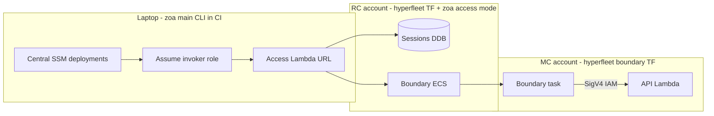

# Pre-PR review: `feat/zoa-boundary` only (both repos)

**Methodology (strict):** Every finding below is tied to **`git diff upstream/main...feat/zoa-boundary`** only. Pre-existing behavior on `main` is **not** credited to this work unless the diff **changes** that behavior.

| Repo                  | Merge-base → HEAD                | Diff size                       |
| --------------------- | -------------------------------- | ------------------------------- |
| `rosa-hyperfleet`     | `1f473e84`…`cb90c07bb` (example) | 65 files, +3016 / −401 lines    |
| `rosa-hyperfleet-zoa` | `47a705e`…`3cea20c` (example)    | 181 files, +16235 / −1255 lines |

**Status:** Local file — **not committed**.

---

## Out of scope — do **not** attribute to boundary branch

These exist on `upstream/main` already; this branch did **not** implement or materially change them:

| Topic                                                    | Evidence on branch diff                                                                                                                                                               |
| -------------------------------------------------------- | ------------------------------------------------------------------------------------------------------------------------------------------------------------------------------------- |
| **`get_secret` HCP namespace / sensitive-name blocks**   | `pkg/actions/getsecret.go`: only `DeploymentTargets` → `TargetTypes` rename + `Examples` with `--reason`. **No change** to `Validate()`, `cluster-*` checks, or blocked secret names. |
| **`get_resource` redirect away from secrets**            | Runtime check `resource == "secrets"` unchanged since `main`; diff is **metadata/description** + examples only.                                                                       |
| **TA executor impersonation, async jobs, core dispatch** | Present before; branch extends (reason, identity bridge, compat), does not invent TA RBAC model.                                                                                      |
| **Lambda Function URL `AWS_IAM` on api/worker**          | Pre-existing; branch adds **access** URL + invoker role (new), does not remove IAM auth on api.                                                                                       |

If a reviewer asks “did this PR add HCP secret protection?” the accurate answer is **no** — only docs/examples around existing TAs were touched.

---

## Executive verdict (boundary diff only)

| Question                                              | Assessment                                                                                                                                                                                                                                                                                                                                                                                                       |
| ----------------------------------------------------- | ---------------------------------------------------------------------------------------------------------------------------------------------------------------------------------------------------------------------------------------------------------------------------------------------------------------------------------------------------------------------------------------------------------------- |
| Stop-the-line issues in **new** boundary/access code? | **None found** in manual review of new surfaces (access API, sessions, exec creds, cross-account ECS, TF boundary IAM, Central SSM).                                                                                                                                                                                                                                                                             |
| Reputational landmines **introduced by this branch**  | (1) **New** laptop/API identity fallback documented as TEMPORARY but **shipped** in `pkg/api/identity.go`. (2) **API contract skew** vs zoa `main` (audit path, `jira`/`reason`) — **compat shims added on branch** (`reason_compat.go`, legacy audit route). (3) **Bedrock module** added to hyperfleet RC stack **in same diff** as boundary. (4) Volume (~19k lines) — not a security defect but review risk. |
| Prod-ready for boundary feature?                      | **Eph/int/stage** after image pin + resync + e2e green. **Tightening** (no laptop → api) is explicitly **future** work in branch docs, not done here.                                                                                                                                                                                                                                                            |

---

## rosa-hyperfleet — what the diff actually adds

### New modules / major TF (review these in PR)

| Path                                                    | Role                                                                                          | Security notes (diff-scoped)                                                                                                                                                |
| ------------------------------------------------------- | --------------------------------------------------------------------------------------------- | --------------------------------------------------------------------------------------------------------------------------------------------------------------------------- |
| `terraform/modules/zoa-access/`                         | Access Lambda, invoker role, Function URL permissions, Central SSM deployment JSON            | Invoker trust = **named** Central roles only (`trusted_assumer_role_names`). SSM writes in **two** Central regions (primary + replica).                                     |
| `terraform/modules/zoa-lambda/boundary-*.tf`            | ECS cluster/task, execution + task roles, API invoke for **task role only**, exec-scoped role | Task role gets `lambda:InvokeFunctionUrl` on **api** with `AWS_IAM`. Egress via NAT (see `boundary-ecs.tf` `0.0.0.0/0` egress — **new** boundary SG, not a new public API). |
| `terraform/modules/zoa-lambda/access-trust-role.tf`     | MC trusts RC access for boundary ECS                                                          | Cross-account **new**; must match `pkg/targetroles` naming.                                                                                                                 |
| `terraform/modules/zoa/dynamodb.tf`, `kms.tf`, `iam.tf` | Sessions table, KMS for sessions/boundary                                                     | **Changed** encryption/access paths for **new** session data.                                                                                                               |
| `terraform/config/regional-cluster/main.tf`             | Wires `zoa_access`, boundary env on `zoa_lambda`, **`module.bedrock`**                        | Bedrock is **new in this diff** — not boundary; no `enable_*` flag.                                                                                                         |
| `terraform/config/pipeline-regional-cluster/`           | CodeBuild SSM in replica Central region                                                       | **Fix for** dual-region SSM apply (was a real integration gap).                                                                                                             |
| `terraform/modules/bedrock/`                            | Account agreements + budget                                                                   | **Unrelated** to boundary; applies on every RC `terraform apply` in this diff.                                                                                              |
| `config/defaults.yaml` + `deploy/`                      | Image tags, boundary timeouts, SSM regions, invoker role names                                | Operational; must match zoa commit (`3cea20c`+ for compat).                                                                                                                 |

### Hyperfleet — findings (diff-only)

| Severity            | Finding                                                                                                                                                                                                                              |
| ------------------- | ------------------------------------------------------------------------------------------------------------------------------------------------------------------------------------------------------------------------------------ |
| **High (accepted)** | Boundary does **not** remove direct laptop → per-VPC API path; TF does not restrict api Function URL to task role only in **this** diff. Epic/docs on zoa branch describe future hardening — **not implemented in hyperfleet diff**. |
| **Medium**          | `module.bedrock` bundled with boundary — reviewers will question scope; shared pool accounts use skip-if-exists scripts (side effects on account primitives).                                                                        |
| **Medium**          | Dual Central SSM region defaults duplicated in `pipeline-regional-cluster` and `regional-cluster` (maintainability, not auth bypass).                                                                                                |
| **Low**             | `terraform/modules/vpc/main.tf` changed — confirm in PR description (subnet/tag drift risk).                                                                                                                                         |
| **Positive (diff)** | Access Lambda **no VPC** + separate invoker role matches zoa access design. Boundary task role → api URL permission is **least-invoker** pattern for in-VPC TA calls.                                                                |

---

## rosa-hyperfleet-zoa — what the diff actually adds

### New packages / files (boundary-relevant)

| Area                     | Files (added or heavily changed)                                                           |
| ------------------------ | ------------------------------------------------------------------------------------------ |
| Access HTTP API          | `pkg/api/access.go`, `access_test.go`, `paths.go`, `audit_actions.go`                      |
| Identity bridge          | `pkg/api/identity.go`, tests; `api.New(..., WithSessionStore)` in `cmd/zoa-lambda/main.go` |
| Sessions / targets store | `pkg/store/session.go`, `target.go`, dynamodb changes                                      |
| Exec join                | `pkg/execcreds/vend.go`, `internal/ecsexec/*`, `internal/cli/session*.go`                  |
| Cross-account ECS        | `pkg/accesscross/ecs.go`                                                                   |
| Reaper                   | `pkg/scheduler/reaper.go`, `pkg/boundaryexec/*`                                            |
| Laptop discovery         | `internal/accessclient/*` (SSM `/zoa/deployments`, failover, overrides)                    |
| Boundary image           | `Containerfile.boundary`, `boundary/*` scripts, bats tests                                 |
| Handler modes            | `cmd/zoa-lambda/main.go` — **new** `access` early return path                              |
| API compat (branch)      | `pkg/api/reason_compat.go`, legacy audit route in `router.go`, `dispatch.go` jira body     |
| CLI surface              | `session`, `deployments`, `targets`, `reason`, audit client path `/audit`                  |

### TA layer — what changed vs what did not

| File                         | Boundary-branch change                                                                        |
| ---------------------------- | --------------------------------------------------------------------------------------------- |
| `pkg/actions/getsecret.go`   | Metadata: `TargetTypes`, examples only — **not** HCP guards                                   |
| `pkg/actions/getresource.go` | Metadata + examples; **same** secret redirect as `main`                                       |
| Other TAs                    | Mostly `--reason` in examples, `DeploymentTargets` → `TargetTypes`, conformance-related churn |

### ZOA — security findings (diff-only)

| Severity                   | Finding                                                                                                                                                                                                                                                                                                           | Where introduced                                     |
| -------------------------- | ----------------------------------------------------------------------------------------------------------------------------------------------------------------------------------------------------------------------------------------------------------------------------------------------------------------- | ---------------------------------------------------- |
| **High (new, documented)** | **Laptop → api Lambda** still resolves operator via `ExtractSREIdentity` when session name is not ECS task id (`pkg/api/identity.go` TEMPORARY comment). **Introduced/enabled** by identity bridge + optional `SessionsTable` on api mode — not a regression, but **new attribution gap** vs boundary-only story. | `identity.go`, `main.go` apiOpts                     |
| **High (new)**             | **`session join` returns STS keys** in JSON (`exec_credentials`). Scoped via `execcreds.sessionPolicy` — **new** secret-bearing response; depends on TLS + SigV4 + no logging.                                                                                                                                    | `access.go`, `execcreds/vend.go`                     |
| **High (new)**             | **Cross-account `AssumeRole`** to start boundary tasks in MC (`accesscross/ecs.go`). Trust policy correctness is **entirely** in hyperfleet TF added in same program.                                                                                                                                             | `accesscross`, `access.go`                           |
| **Medium (new)**           | **Central SSM deployment discovery** on laptop reads `/zoa/deployments/*` in Central (two regions). Compromise of Central read IAM exposes Access URL + invoker ARN — **new** discovery attack surface vs per-env manual config.                                                                                  | `deployments_ssm.go`, hyperfleet `zoa-access/ssm.tf` |
| **Medium (new)**           | **Compat shims** duplicate audit route + accept `jira` JSON + legacy invalid-jira error text — **new** code paths until ROSAENG-60291; same auth as canonical routes.                                                                                                                                             | `router.go`, `reason_compat.go`, `dispatch.go`       |
| **Medium (new)**           | Boundary container: **Claude Code** with `defaultMode: acceptEdits` (`boundary/home-sre/.claude/settings.json`) — **new** operator risk (AI edits in session).                                                                                                                                                    | `Containerfile.boundary`, settings                   |
| **Low (new)**              | `pkg/targetroles` — no tests in diff; thin ARN helper for cross-account.                                                                                                                                                                                                                                          | `targetroles/roles.go`                               |
| **Low (new)**              | Temporary `--jira` CLI flag (`run.go`, `session.go`) — same field as `--reason`; removal planned.                                                                                                                                                                                                                 | `internal/cli`                                       |

### ZOA — architecture / integration (diff-only)

| Topic                                           | Assessment                                                                                                                                                              |
| ----------------------------------------------- | ----------------------------------------------------------------------------------------------------------------------------------------------------------------------- |
| **Three handler modes in one binary**           | **New** `access` path cleanly short-circuits before EKS/S3 setup (`main.go`) — good separation.                                                                         |
| **Identity bridge**                             | **New** coupling: api Lambda needs `SESSIONS_TABLE` + boundary must write `task_id` on activate — documented in `boundary-identity-and-storage.md` (**added** in diff). |
| **Audit route move**                            | **Changed** canonical path to `/api/v0/audit`; **compat** restores `/trusted-actions/audit` for zoa `main` CLI — integration fix, not rollback of design.               |
| **`reason` vs `jira`**                          | **Changed** API to `reason`; branch adds **compat** for hyperfleet e2e cloning `main` CLI.                                                                              |
| **parambind / actioncatalog / offline catalog** | **New** CLI/docs structure — aligns describe with run flags; large but coherent with branch.                                                                            |
| **Epic plan doc**                               | **Added** `zoa-boundary-epic-plan.md` — much larger than code delta; use as background, not PR checklist.                                                               |

### ZOA — code quality (diff-only)

| Aspect | Notes                                                                                                                               |
| ------ | ----------------------------------------------------------------------------------------------------------------------------------- |
| Tests  | **New** code mostly has `_test.go`; `go test ./...` passes on branch. E2e under `test/e2e/` **changed** for `--reason`, audit, etc. |
| Shell  | **New** bats for boundary entrypoint/banner — matches boundary container investment.                                                |
| Style  | Follows existing zoa patterns; heavy CLI churn is **in diff** but mechanical (reason, target type rename).                          |

---

## Cross-repo coupling (both diffs together)



**This diagram is only valid after both PRs deploy.** Image tag in hyperfleet must match zoa API compat commits (`e06394b`+, `3cea20c`+).

---

## PR checklist (boundary diff accountability)

- [ ] PR description states **HCP secret guards are unchanged** (only TA metadata/examples touched).
- [ ] PR description states **laptop → api Lambda** is still allowed; boundary is additive.
- [ ] List **compat shims** and ROSAENG-60291 removal criteria (zoa `main` merged + images rolled).
- [ ] Justify or split **`module.bedrock`** out of boundary hyperfleet PR.
- [ ] Ephemeral e2e green with **default** `ZOA_REF=main` and pinned image **`3cea20c`** or newer.
- [ ] hyperfleet: RC pipeline reprovisioned if Central replica SSM IAM was missing.

---

## Manual smoke (tests **new** paths only)

```bash
# Access plane (new) — after deployments SSM populated
zoa deployments
zoa targets <deployment>
zoa session start <deployment> regional --reason ROSAENG-1234 --no-connect

# Legacy audit URL (compat added on branch) — use zoa main-built CLI
zoa audit --since 10m -o json

# Identity bridge (new) — from inside boundary after session active
# ZOA_API_URL set → zoa run uses task id → session lookup
```

Do **not** use passing `get_secret` in cluster-* as proof of **this** PR — that behavior predates the branch.

---

## Summary

Rigorous read: **boundary branch adds** session/access/cross-account/exec/reaper/discovery infrastructure and the TF to run it. It does **not** add HCP secret guards. The main security story you own in review is **new trust boundaries** (invoker role, exec cred vending, cross-account ECS, Central SSM, laptop API fallback), plus **honest disclosure** of compat and scope (Bedrock, volume). Small doc/example churn on TAs should not be oversold as new security controls.
